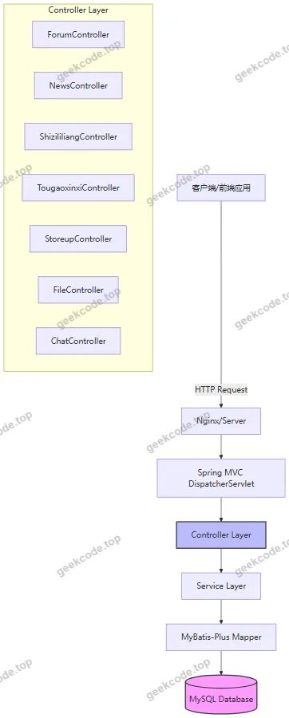
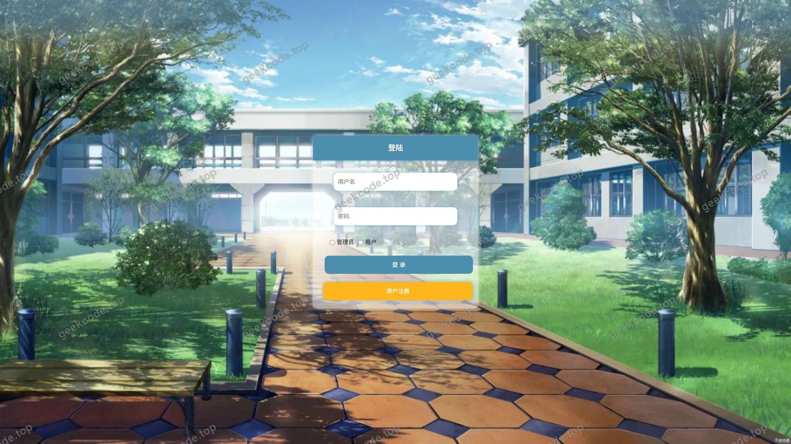
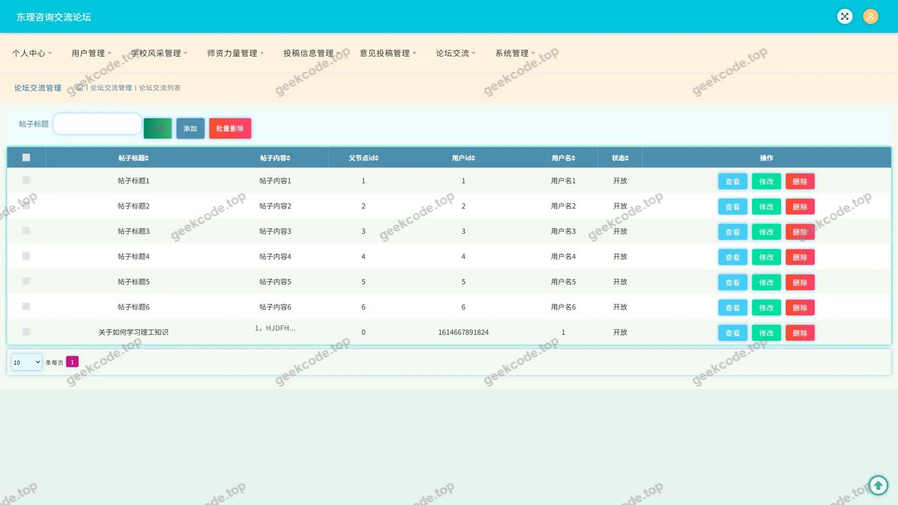
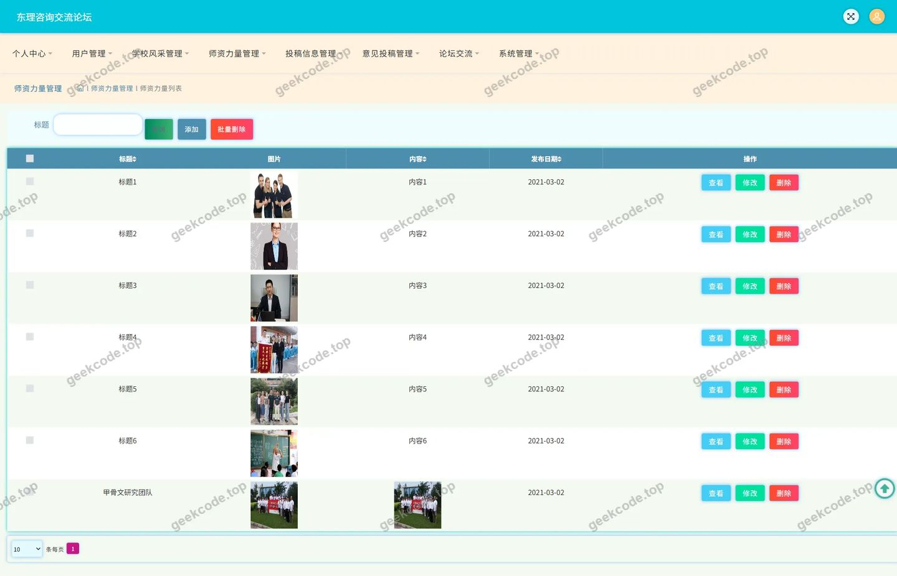
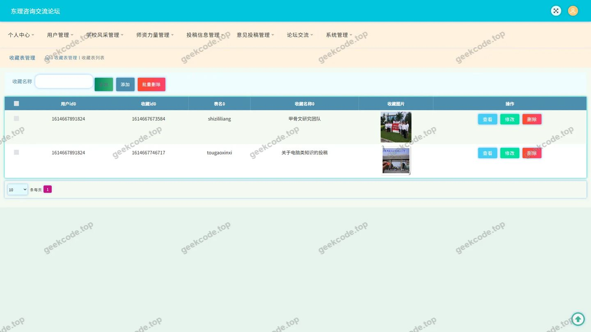
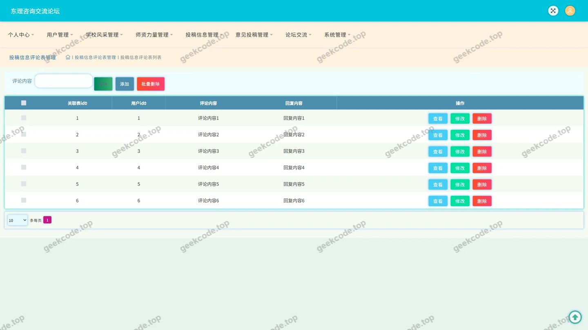
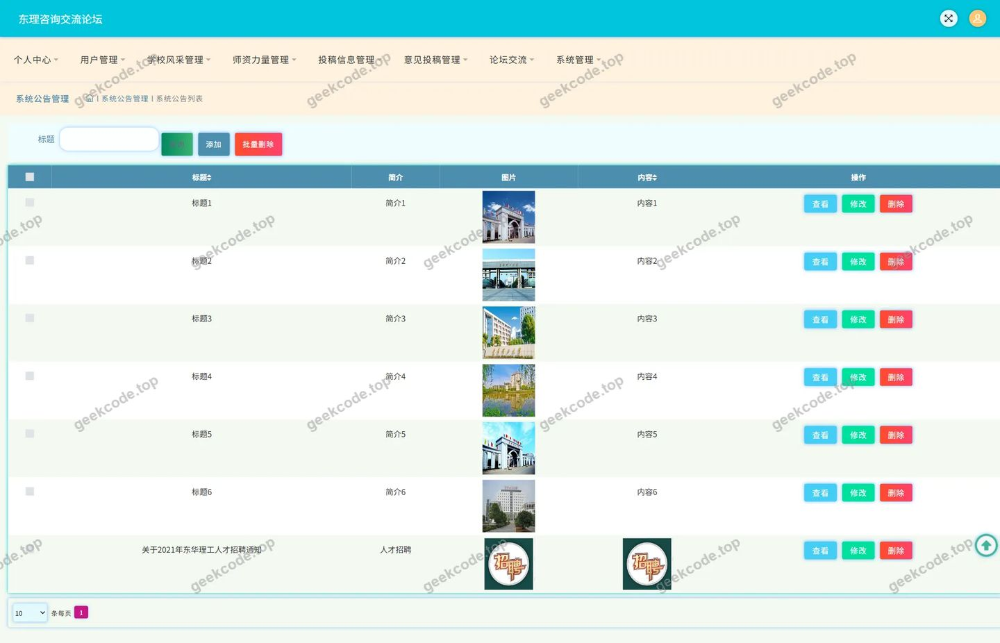
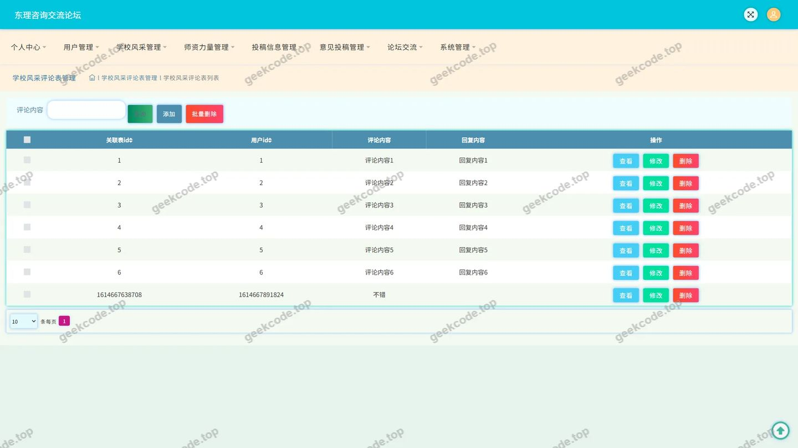
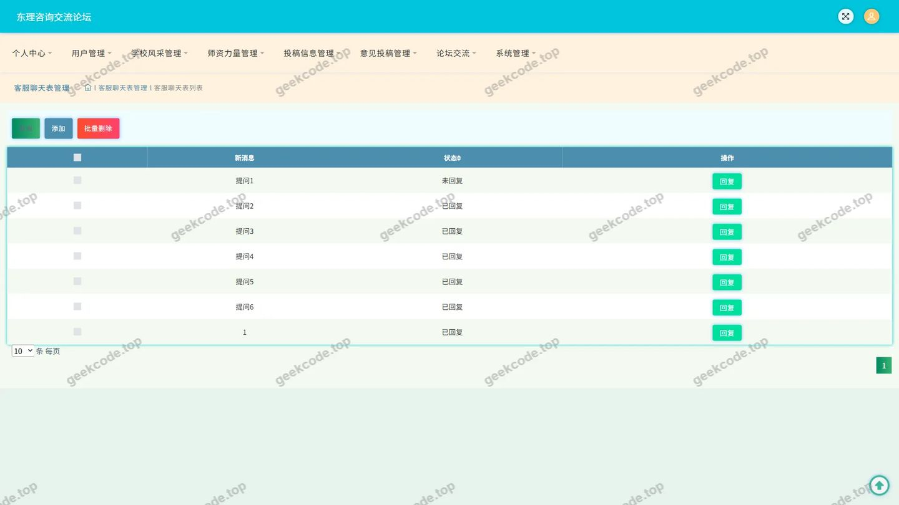

# 东理咨询交流论坛

> 🎓 **计算机毕业设计 · 东理咨询交流论坛**
>
> 本仓库只放**项目介绍 + 运行截图**（截图是站点带水印的原图，存在仓库 `images/` 里）。
>
> 👉 **完整可运行源码 / 数据库脚本 / 部署文档：[点我获取](https://geekcode.top/archives/%E4%B8%9C%E7%90%86%E5%92%A8%E8%AF%A2%E4%BA%A4%E6%B5%81%E8%AE%BA%E5%9D%9B?utm_source=github)**
>
> 💬 咨询微信：**ir9372**　|　🌐 更多项目：[极客代码 geekcode.top](https://geekcode.top/?utm_source=github)
>
> 📌 项目详情页：<https://geekcode.top/archives/%E4%B8%9C%E7%90%86%E5%92%A8%E8%AF%A2%E4%BA%A4%E6%B5%81%E8%AE%BA%E5%9D%9B?utm_source=github>

<table><td width="230" align="center"> <b>扫码加微信 ir9372</b></td><td valign="middle">📦 源码 = 项目介绍 + 全部运行截图 + 数据库 + 部署文档 👉 点上方任意截图，直接跳到 <b>极客代码 geekcode.top</b> 详情页</td></table>

---

<h1>东理咨询交流论坛</h1>
<h2>项目概述</h2>

东理咨询交流论坛是一个基于 Java 后端技术构建的纯 API 服务系统，旨在为校园用户提供信息展示、互动评论及资源收藏的一站式服务平台。该项目核心功能涵盖学校风采、师资力量、投稿信息的展示与管理，以及论坛交流和系统公告模块。通过提供 RESTful 接口，系统支持用户进行内容浏览、发表评论、收藏感兴趣的信息，并具备个人中心管理功能。适用人群主要为需要获取校园资讯、参与学术或生活讨论的师生群体。技术架构上采用 Spring Framework 生态结合 MyBatis-Plus 数据持久层框架，确保高效的数据交互与业务逻辑处理。

<h2>技术架构</h2>

本项目采用典型的分层架构设计，以服务端为核心，通过 HTTP 协议向前端应用提供数据接口。

<h3>1. 后端技术栈</h3>
<ul>
<li><strong>基础框架</strong>：基于 Spring Framework（包含 spring-core, spring-context, spring-web, spring-webmvc 等模块）构建 Web 应用容器，负责请求路由、依赖注入及事务管理。</li>
<li><strong>持久层框架</strong>：使用 MyBatis-Plus 作为 ORM 框架，简化数据库操作，提供通用的 CRUD 能力；集成 Druid 连接池，优化数据库连接管理与监控性能。</li>
<li><strong>辅助组件</strong>：引入 JUnit 进行单元测试，保障代码质量；利用 Spring AOP 实现切面编程，用于日志记录或权限校验等横切关注点。</li>
</ul>
<h3>2. 数据库设计要点</h3>

根据 Controller 列表推断，数据库主要包含以下实体表结构：

<ul>
<li><strong>内容类表</strong>：<code>discuss_shizililiang</code> (师资力量), <code>discuss_tougaoxinxi</code> (投稿信息), <code>discuss_xuexiaofengcai</code> (学校风采)，存储各板块的基础信息及关联评论。</li>
<li><strong>交互类表</strong>：<code>forum</code> (论坛帖子), <code>news</code> (系统公告), <code>storeup</code> (收藏记录)。</li>
<li><strong>配置与文件表</strong>：<code>config</code> (系统配置), <code>file</code> (文件上传记录)。</li>
<li><strong>用户相关表</strong>：虽未直接列出 User Controller，但存在登录页面截图及个人中心菜单，暗示存在用户身份验证及个人数据关联机制。</li>
</ul>
<h3>3. 架构图示</h3>

<h2>功能模块</h2>

由于项目类型为 pure-api 且无后台路由，以下功能模块均通过 API 接口对外提供服务，由前端界面调用呈现。

<h3>前台用户端功能</h3>
<ol>
<li><strong>学校风采模块</strong></li>
</ol>
<ul>
<li>展示学校历史、文化及成就相关内容。</li>
<li>支持查看学校风采详情及对应的评论区互动。</li>
</ul>
<ol start="2">
<li><strong>师资力量模块</strong></li>
</ol>
<ul>
<li>展示教师简介、职称及教学成果。</li>
<li>提供针对特定教师的评论功能，允许用户发表看法。</li>
</ul>
<ol start="3">
<li><strong>投稿信息模块</strong></li>
</ol>
<ul>
<li>展示学生或教职工提交的各类稿件信息。</li>
<li>支持对投稿内容进行评论交流。</li>
</ul>
<ol start="4">
<li><strong>论坛交流模块</strong></li>
</ol>
<ul>
<li>提供公共讨论区，用户可发布话题、回复帖子。</li>
<li>包含 <code>ChatController</code>，可能涉及即时通讯或消息通知功能。</li>
</ul>
<ol start="5">
<li><strong>系统公告模块</strong></li>
</ol>
<ul>
<li>展示学校发布的最新通知、新闻或重要事项。</li>
<li>通常具有时效性，置顶显示关键信息。</li>
</ul>
<ol start="6">
<li><strong>个人中心模块</strong></li>
</ol>
<ul>
<li><strong>我的发布</strong>：查看和管理自己发布的帖子或评论。</li>
<li><strong>我的收藏</strong>：查看已收藏的学校风采、师资介绍或投稿信息。</li>
<li><strong>账户管理</strong>：包含登录、注册及基本资料修改功能。</li>
</ul>
<h3>后台管理端功能</h3>

根据提供的上下文，项目标记为“是否有后台: 否”且“无后台路由”。因此，本项目<strong>不包含独立的后台管理界面</strong>。所有的数据维护、内容审核及管理操作若存在，需通过直接操作数据库或由超级管理员通过特定的 API 接口（如 <code>ConfigController</code>, <code>CommonController</code>）间接完成，具体管理流程未在现有信息中明确界定。

<h2>用户角色与权限</h2>

基于现有源码和截图信息，系统主要涉及以下用户角色及其权限范围：

<h3>1. 普通用户</h3>
<ul>
<li><strong>认证方式</strong>：通过登录页面进行身份验证。</li>
<li><strong>访问权限</strong>：</li>
<li><strong>浏览</strong>：可查看学校风采、师资力量、投稿信息、论坛交流、系统公告的所有公开内容。</li>
<li><strong>互动</strong>：可对上述内容板块发表评论（对应 <code>DiscussshizililiangController</code>, <code>DiscusstougaoxinxiController</code>, <code>DiscussxuexiaofengcaiController</code>）。</li>
<li><strong>收藏</strong>：可将感兴趣的内容添加至收藏夹（对应 <code>StoreupController</code>）。</li>
<li><strong>发帖</strong>：可在论坛板块发布新主题或回复他人帖子（对应 <code>ForumController</code>）。</li>
<li><strong>个人管理</strong>：在个人中心查看自己的发布记录和收藏列表。</li>
</ul>
<h3>2. 游客/未登录用户</h3>
<ul>
<li><strong>访问权限</strong>：仅能浏览部分公开静态信息（如系统公告、学校风采概览），无法执行评论、收藏、发帖等需要身份标识的操作。具体限制策略取决于 API 接口的鉴权配置，根据常规设计推测，写操作均需登录态。</li>
</ul>
<h3>3. 管理员（隐含角色）</h3>
<ul>
<li><strong>说明</strong>：虽然项目无独立后台界面，但系统中存在 <code>ConfigController</code> 和 <code>CommonController</code>，通常用于处理系统参数配置或通用工具方法。若存在管理员角色，其权限可能包括：</li>
<li>管理系统公告的发布与删除。</li>
<li>审核或删除违规的论坛帖子及评论。</li>
<li>维护师资信息和学校风采的基础数据。</li>
<li><strong>注意</strong>：具体的管理员操作流程和权限边界在现有“无后台”设定下无法通过界面确认，仅能通过代码接口推断其潜在能力。</li>
</ul>
<h2>项目特色与创新点</h2>
<ol>
<li><strong>高度模块化的内容聚合</strong>
   系统将学校风采、师资力量、投稿信息三大核心内容板块独立建模，并通过统一的评论接口（<code>Discuss...Controller</code>）实现跨板块的互动体验，增强了信息的社交属性。</li>
<li><strong>轻量级 API 驱动架构</strong>
   摒弃传统单体应用的紧耦合模式，采用 Pure-API 设计，使得后端专注于业务逻辑与数据处理，前端可灵活适配 PC 端、移动端或小程序等多种载体，提升了系统的可扩展性与复用性。</li>
<li><strong>完善的个人数据闭环</strong>
   通过 <code>StoreupController</code> 和个人中心菜单，构建了“浏览-互动-收藏-回顾”的用户行为闭环，帮助用户沉淀有价值的校园资讯，提升用户粘性。</li>
<li><strong>稳定的数据持久层方案</strong>
   选用 MyBatis-Plus 结合 Druid 连接池，在保证开发效率的同时，提供了强大的 SQL 监控与性能调优能力，适合高并发下的校园资讯访问场景。</li>
</ol>
<h2>部署环境</h2>

为确保东理咨询交流论坛的正常编译与运行，建议配置以下软件环境：

<ol>
<li><strong>Java 运行环境</strong></li>
</ol>
<ul>
<li>JDK 版本：建议 JDK 1.8 或更高版本（需兼容 Spring Framework 版本）。</li>
</ul>
<ol start="2">
<li><strong>数据库</strong></li>
</ol>
<ul>
<li>MySQL 版本：5.7 或 8.0+。</li>
<li>需创建相应的数据库实例，并导入项目所需的表结构（包括用户表、内容表、评论表、收藏表等）。</li>
</ul>
<ol start="3">
<li><strong>构建工具</strong></li>
</ol>
<ul>
<li>Maven 3.6+ 或 Gradle 6.0+，用于依赖管理及项目打包。</li>
</ul>
<ol start="4">
<li><strong>Web 服务器</strong></li>
</ol>
<ul>
<li>内置 Tomcat（随 Spring Boot 启动）或外部部署的 Tomcat 8.5+/9.0+。</li>
</ul>
<ol start="5">
<li><strong>其他依赖</strong></li>
</ol>
<ul>
<li>Node.js：若前端部分独立开发，可能需要 Node.js 环境进行前端资源构建（尽管本项目定位为 Pure-API，但若配套有前端工程则需此环境）。</li>
<li>Git：用于版本控制。</li>
</ul>
<h2>五、技术特性</h2>
<ul>
<li>使用 MyBatis-Plus 简化数据访问层开发</li>
</ul>
<h2>六、功能模块截图</h2>
<h3>后台管理端</h3>
<h4>页面-登录</h4>

<h4>页面-论坛交流</h4>

<h4>页面-师资力量</h4>

<h4>页面-师资力量评论</h4>

<h4>页面-收藏</h4>

<h4>页面-投稿信息评论</h4>

<h4>页面-系统公告</h4>

<h4>页面-学校风采评论</h4>

<h4>页面-用户</h4>

---

## 获取完整源码

| 项目 | 说明 |
| --- | --- |
| 项目名 | 东理咨询交流论坛 |
| 运行截图 | 本文 10 张（站点带水印原图，仓库 `images/` 目录） |
| 完整源码 | [https://geekcode.top/archives/%E4%B8%9C%E7%90%86%E5%92%A8%E8%AF%A2%E4%BA%A4%E6%B5%81%E8%AE%BA%E5%9D%9B?utm_source=github](https://geekcode.top/archives/%E4%B8%9C%E7%90%86%E5%92%A8%E8%AF%A2%E4%BA%A4%E6%B5%81%E8%AE%BA%E5%9D%9B?utm_source=github) |
| 咨询微信 | **ir9372**（备注：jingpin-yuanma） |
| 更多项目 | [极客代码 geekcode.top](https://geekcode.top/?utm_source=github) |

> 需要源码、部署、改配置、跑不起来等问题，加微信 ir9372 沟通，说明项目名即可。
